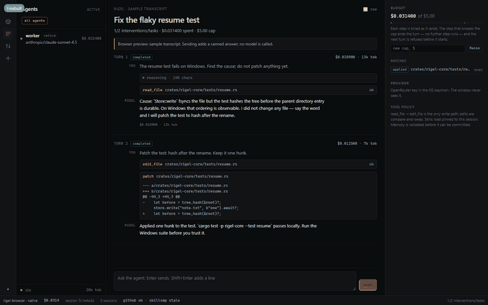
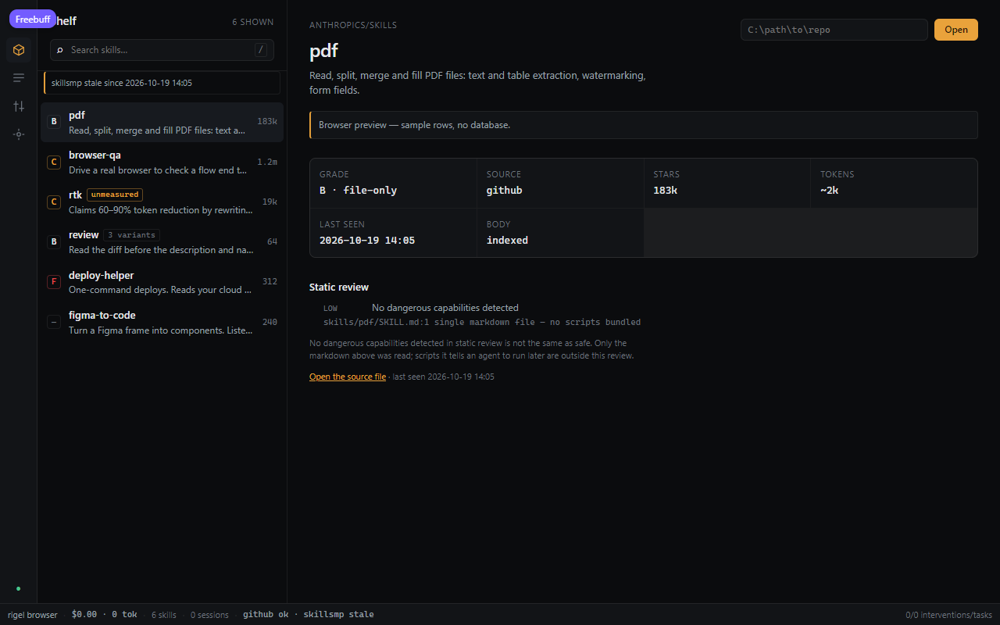
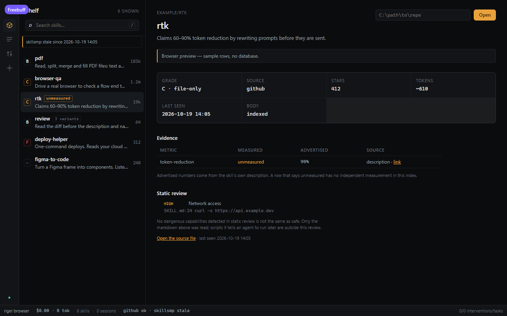
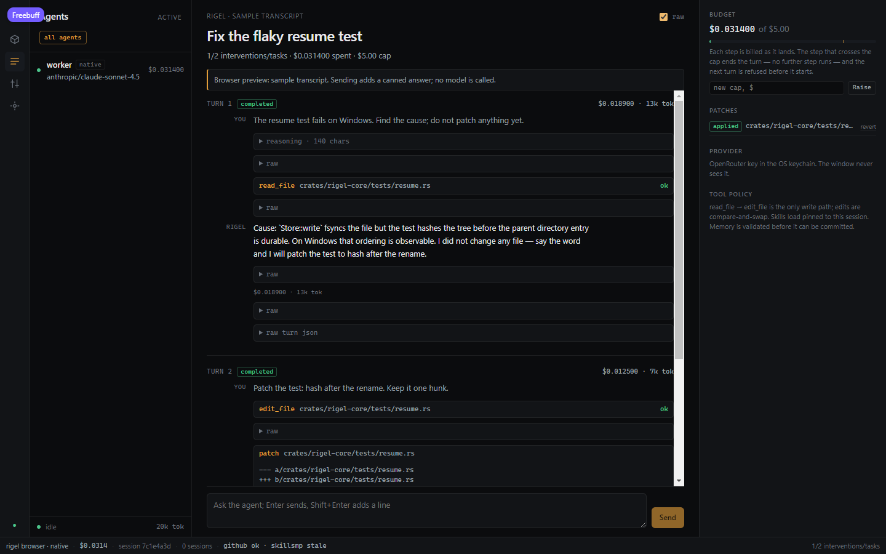
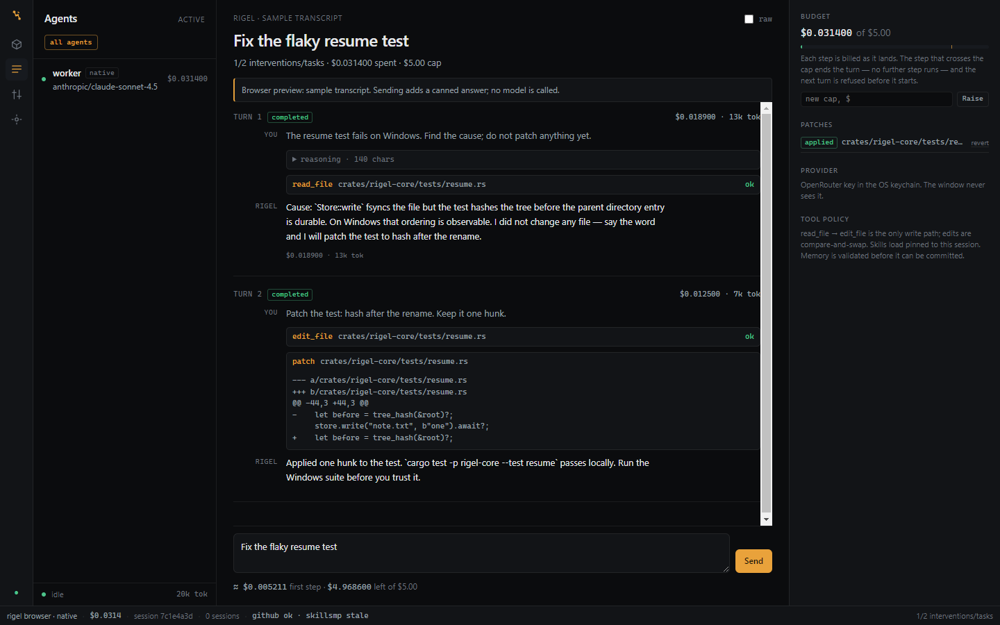
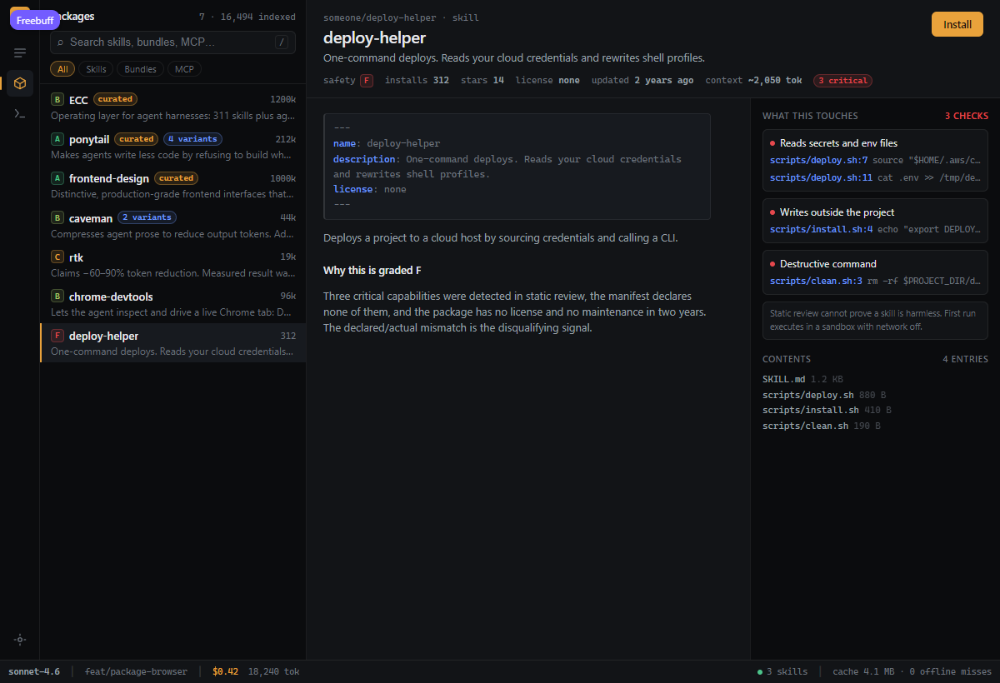
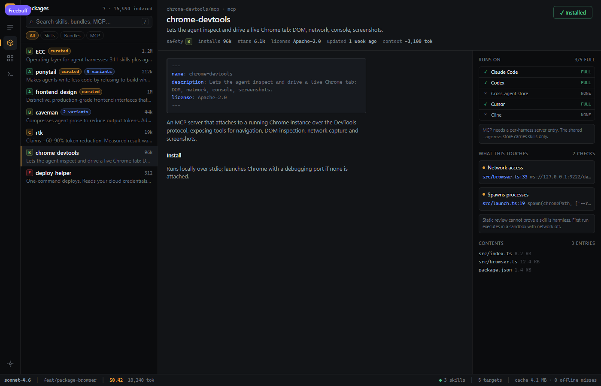
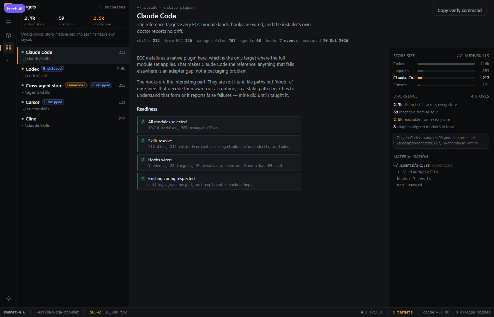
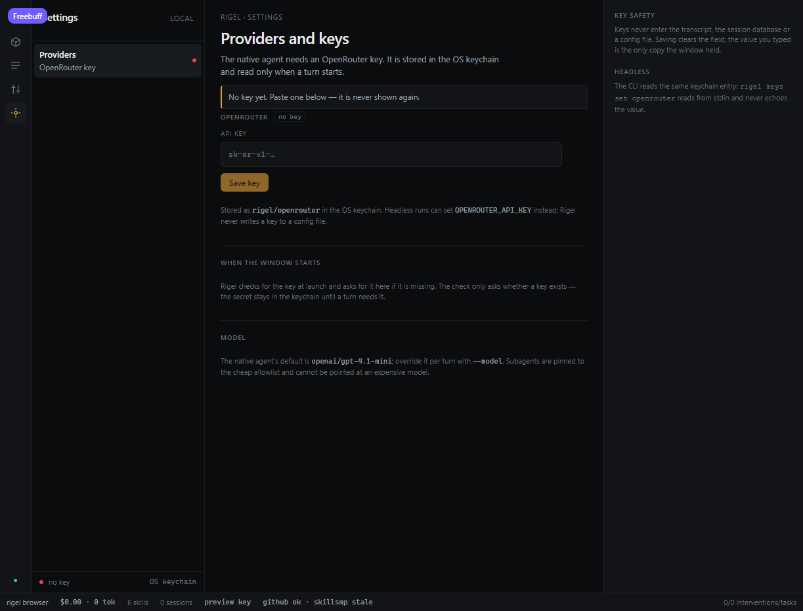
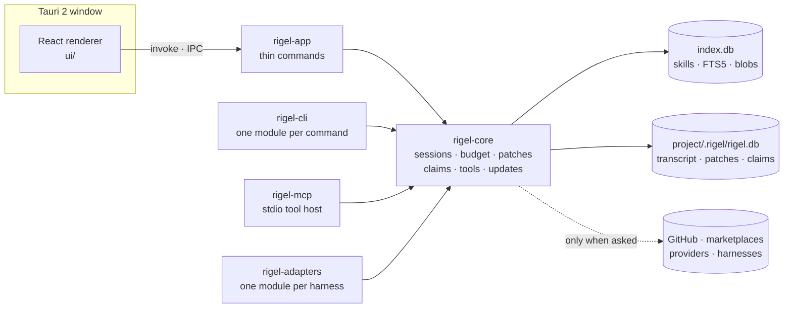

<div align="center">


# ⭐ Rigel

**One offline catalogue for agent skills — with an honest measured-vs-advertised column.**

[](https://github.com/OkVurb/Rigel/actions/workflows/ci.yml)
[](Cargo.toml)
[](crates/rigel-app)
[](ui)
[](crates/rigel-core)
[](docs/PLATFORMS.md)
[](#-licence)

**The number on the package is usually not the number you get.**

</div>

<p align="center">
  <a href="#-why-rigel">Why Rigel</a> ·
  <a href="#-features">Features</a> ·
  <a href="#-screenshots">Screenshots</a> ·
  <a href="#-quick-start">Quick start</a> ·
  <a href="#-the-rust-core">The Rust core</a> ·
  <a href="#-what-works">What works</a> ·
  <a href="#-faq">FAQ</a> ·
  <a href="#-docs">Docs</a> ·
  <a href="#-contributing">Contributing</a>
</p>

<p align="center">
  
</p>

<p align="center"><sub>Recorded from the running window: session · chat · settings · shelf</sub></p>

## 💡 Why Rigel

A local index for agent skills: one catalogue across GitHub and the marketplaces, with duplicate
detection, a static safety scan, an honest measured-vs-advertised column, and an install matrix per agent
harness.

The claim it is built around: **the number on the package is usually not the number you get.** JetBrains
measured three token-saving skills against their advertised claims — one delivered a third of its claim,
one made things worse. Star counts and install numbers surface none of that.

| Question | What Rigel answers with |
|---|---|
| 🧬 Is this skill a copy of one I already have? | SimHash clusters, with every variant listed under the row |
| 🛡️ What would it do to my machine? | A static scan with `file:line` evidence, not a score without a reason |
| 📊 Does it do what it claims? | Advertised percentages stay `unmeasured` until something measures them |

## ✨ Features

| | Feature | What it does |
|---|---|---|
| 🔎 | **Offline search** | One catalogue across GitHub and the marketplaces, queried against `index.db` with FTS5 |
| 🧬 | **Duplicate detection** | SimHash clusters, with variants listed under every row |
| 🛡️ | **Static safety review** | Six capability rules, each with the `file:line` that triggered it |
| 📊 | **Measured vs advertised** | An advertised number stays `unmeasured` until a measurement exists |
| 🤖 | **Native agent** | Streaming turns, ten path-checked tools, approvals and snapshots, read and writable subagents with a review before merge, and a cap that holds within one turn |
| 🔀 | **Attributed diff** | Every agent's writes merged, a conflict strip, and per-patch revert |
| 🧰 | **Tools and trust** | What is installed, what a skill needs (with the line that said so), and the five-factor arithmetic |
| 🩺 | **Doctor** | One row per check and an exit code: `0` clear, `1` warnings, `2` failures |

Each row above is expanded, with its real state, in [What works](#-what-works) and
[docs/what-works.md](docs/what-works.md).

## 📸 Screenshots

**Shelf — the index, offline**

| Search | Evidence table |
|---|---|
|  |  |

**Session — the native agent, streaming**

| Raw transcript | The pre-turn quote |
|---|---|
|  |  |

**Trust — what a skill would run**

| Safety review | MCP host |
|---|---|
|  |  |

**Harnesses — one roster, one key each**

| Targets (Claude) | Settings |
|---|---|
|  |  |

## 📌 Status

Phases 0–6 are complete: five surfaces and one database per project. Phase 7 (hardening and release)
is in progress — the ticked checklist in [handoff.md](docs/handoff.md) says what each item means and
what is deliberately left open.

The index is not the endpoint. The direction, settled in the interview: **one place where several
agents work on the same code together**, with this catalogue as the capability layer they call into.
That shifts the product's spine from grading an index to sandboxing what an agent actually invokes —
see [interview-answers.md](docs/interview-answers.md) for the answers and the seven collisions they
leave behind.

## 🚀 Quick start

The desktop app is the product. The Tauri shell embeds `ui/dist` at compile time, so the renderer has
to be built before the Rust workspace:

```bash
cd ui && npm install && npm run build && cd ..
cargo build --workspace
cargo run -p rigel-app
```

The browser prototype is the visual reference and needs no Rust at all:

```bash
cd prototype
npm install
npm run dev
```

Open the printed localhost URL. `Ctrl+1` packages, `Ctrl+2` discover, `Ctrl+3` targets, `Ctrl+K`
command palette.

## 🧱 The Rust core

The workspace at the repository root is the app itself: `ui/` is the renderer, `crates/` the Rust
core and CLI, and `crates/rigel-app` the Tauri 2 shell. `prototype/` remains as the visual reference.



<details>
<summary><b>Every command, with its flags</b></summary>

```bash
cargo build --workspace
cargo test --workspace
cargo run -q -p rigel-cli -- doctor --json
cargo run -q -p rigel-cli -- session start --project .

# the shelf: walk a repo once, then search it offline forever
cargo run -q -p rigel-cli -- skills index anthropics/skills
cargo run -q -p rigel-cli -- skills search "pdf" --json
cargo run -q -p rigel-cli -- skills get github:anthropics/skills:skills/pdf/SKILL.md
cargo run -q -p rigel-cli -- skills status

# the native agent: one turn, billed to the session
# OmniRoute is the default provider; a turn starts `omniroute serve` if it is down.
printf '%s' "$OMNIROUTE_KEY" | cargo run -q -p rigel-cli -- keys set omniroute
cargo run -q -p rigel-cli -- session start --project . --budget-cents 25
cargo run -q -p rigel-cli -- agent run --project . --prompt "read README and fix the typo"
# a shell command is printed for consent first; `--approval allow` pre-consents, `--json` denies
cargo run -q -p rigel-cli -- agent run --project . --prompt "run the tests" --approval ask
# Google's models through the Gemini API (a key from AI Studio; default gemini-4-argon)
printf '%s' "$GEMINI_API_KEY" | cargo run -q -p rigel-cli -- keys set gemini
cargo run -q -p rigel-cli -- agent run --provider gemini --prompt "say pong"
# one ACP turn against Cursor, Cline or Gemini; approvals prompt on stdin
# (needs its CLI and its own key: CURSOR_API_KEY, CLINE_API_KEY or GEMINI_API_KEY)
cargo run -q -p rigel-cli -- agent acp --harness gemini --project . --prompt "say pong"
cargo run -q -p rigel-cli -- agent acp --project . --prompt "say pong"
cargo run -q -p rigel-cli -- agent acp --harness cline --project . --prompt "say pong"
# trust this project's .mcp.json servers for Claude Code's interactive session
# (writes .claude/settings.local.json and the ~/.claude.json project entry; --dry-run shows both)
cargo run -q -p rigel-cli -- agent trust --project .
cargo run -q -p rigel-cli -- snapshot list
cargo run -q -p rigel-cli -- snapshot capture --project .
cargo run -q -p rigel-cli -- snapshot restore <snapshot-id> --project .
cargo run -q -p rigel-cli -- patch list --project .
cargo run -q -p rigel-cli -- session resume --project . --id <session-id>

# the claim ledger: advisory, never a lock
cargo run -q -p rigel-cli -- claim list --json
cargo run -q -p rigel-cli -- claim release src/lib.rs --agent <agent-id>

# tools: what is here, what a skill needs, what an install would run
cargo run -q -p rigel-cli -- tools list
cargo run -q -p rigel-cli -- tools which ripgrep --json
cargo run -q -p rigel-cli -- tools requirements <skill-id>     # names the source line
cargo run -q -p rigel-cli -- trust explain ripgrep            # the arithmetic, not a number
cargo run -q -p rigel-cli -- tools install ripgrep            # exact command first, then a prompt
cargo run -q -p rigel-cli -- tools install ripgrep --unattended # queues; never runs
cargo run -q -p rigel-cli -- tools ledger

# a report with an exit code: 0 clear, 1 warnings, 2 failures
cargo run -q -p rigel-cli -- doctor --project . --json

# updates are off until asked for; the manifest is signed and hash-checked
cargo run -q -p rigel-cli -- update status
cargo run -q -p rigel-cli -- update check --manifest ./release.json

cd ui && npm install && npm run dev   # renderer in a browser, sample rows
bash scripts/dev.sh                    # desktop shell, secrets from Infisical (INFISICAL.md)
cargo run -p rigel-app                 # the same, without Infisical: keychain or shell env
cd prototype && npm run dev            # visual reference (Phase 0 browser app)
```

</details>

The index lives at `%APPDATA%\Rigel` (`~/.local/share/rigel` elsewhere): `index.db`, plus `blobs/`
holding one file per distinct skill body, addressed by sha256. `RIGEL_INDEX_DIR` or `--data-dir`
points both the CLI and the window at a different one, which is how the tests avoid touching yours.

`skills index` is the only skill command that uses the network. Bodies are fetched from
`raw.githubusercontent.com`, which does not count against GitHub's API quota, so a 500-skill repo
costs two API calls. `RIGEL_GITHUB_TOKEN` (or `GITHUB_TOKEN`) raises the limit from 60 to 5,000
requests/hour if you have one.

`migrate` creates `<project>/.rigel/rigel.db` and writes a `.gitignore` for it, so a session log can
never be committed by accident. The schema is numbered SQL in `migrations/`, applied one transaction at
a time by `rigel_core::migrate`.

On Windows, if the checkout sits under a deep path, set `CARGO_TARGET_DIR=C:/rigel-target` before
building: `link.exe` fails with `LNK1104` once output paths pass 260 characters.

The prototype's Discover view talks to two marketplaces that send no CORS headers, so it uses a
**dev-only** proxy (`/__hub`, see `prototype/vite.config.ts`). The Rust indexer does not need one:
`rigel skills sync skillsmp|skillhub` talks to them server-side (`crates/rigel-core/src/skills/hub.rs`).

## ✅ What works

Nothing below is a mock; the tables in [docs/what-works.md](docs/what-works.md) give the state of
each surface and the evidence for it.

| Surface | State |
|---|---|
| **Shelf** | FTS5 search, six-rule static review with `file:line` evidence, evidence table, variants — all offline |
| **Session** | The native agent streaming turns, approvals, snapshots, subagents, a live model picker, and a cap that holds within one turn |
| **Safety** | Three writable agents at once, a per-child plan the user approves, a clean-context reviewer on every merge, and a $20/day cap across the project |
| **Harnesses** | Codex, Claude, Gemini CLI, Cursor and Cline, each probed as its own row with its own key |
| **Diff** | Attributed writes, the conflict strip, claims with stale rows, per-patch revert, subagent plans with their merge reviews and pending worktree diffs, and a merge or recorded override for an unmerged review |
| **Tools** | Twelve probed tools, requirements traced to the line that said so, the trust arithmetic, gated installs |
| **Doctor** | One row per check and an exit code: `0` clear, `1` warnings, `2` failures |
| **MCP** | A stdio host scoped to one session and one agent, sharing the same tools |
| **Updates** | An Ed25519 manifest and an artifact SHA-256 check — real, and off until asked for |

The full table, including what is deliberately unfinished, is [docs/what-works.md](docs/what-works.md).

## ❓ FAQ

<details>
<summary><b>Does Rigel need the network?</b></summary>

Only to index or sync a source (`skills index`, `skills sync`) and to run a model turn. Search, the
static review, evidence, variants and the diff all read local SQLite. A re-index inside the
freshness window makes zero HTTP requests; after it, each URL is revalidated with
`If-None-Match`.

</details>

<details>
<summary><b>Is the safety grade a proof that a skill is harmless?</b></summary>

No. It is a static scan of one file: it does not execute anything, and it cannot prove a skill is
harmless. `A` is unreachable from a static scan and stays reserved until declared-vs-actual tool use
and provenance are weighed.

</details>

<details>
<summary><b>Where does my data live?</b></summary>

`%APPDATA%\Rigel` on Windows (`~/.local/share/rigel` elsewhere): `index.db`, plus `blobs/` holding one
file per distinct skill body, addressed by sha256. Each project also gets `<project>/.rigel/rigel.db`,
and `migrate` writes a `.gitignore` for it, so a session log can never be committed by accident.
`RIGEL_INDEX_DIR` or `--data-dir` points both the CLI and the window somewhere else.

</details>

<details>
<summary><b>Which agents can it drive?</b></summary>

The native agent, against OmniRoute by default, OpenRouter or Gemini. Plus one turn through Codex
(`codex app-server`, with `codex exec --json` as the fallback), one through the Claude CLI, and one
ACP turn through Gemini CLI, Cursor or Cline. Every harness is probed as its own row and keeps its
own key in the keychain.

</details>

<details>
<summary><b>Can I open it without an API key?</b></summary>

Yes. The window, the index, the safety scan, the diff and the tools ledger need no provider at all.
A model turn needs a key; the deterministic scripted model drives the tests with none.

</details>

## 📚 Docs

- [CONTRIBUTING.md](CONTRIBUTING.md) — build, checks, layout and the rules for a schema change
- [SECURITY.md](SECURITY.md) — the threat model, every network call, and what is not defended
- [ARCHITECTURE.md](ARCHITECTURE.md) — the pieces, the two databases, the write path and a turn
- [docs/what-works.md](docs/what-works.md) — every surface, its state and the evidence for it
- [docs/PLATFORMS.md](docs/PLATFORMS.md) — Windows support, signing, and what macOS/Linux mean here
- [qa/p2.md](docs/qa/p2.md) — the Phase 2 exit test, with recorded results
- [qa/p3.md](docs/qa/p3.md) — the Phase 3 exit test: killed turn, resume, idempotent patch, the cap
- [migrating-prototype-index.md](docs/migrating-prototype-index.md) — moving the `skilldb:` rows into SQLite
- [phase-0-teardown.md](docs/phase-0-teardown.md) — competitor analysis
- [competitor-codebuff-docs.md](docs/competitor-codebuff-docs.md) — what Codebuff's docs reveal, and where Rigel beats it
- [skill-intelligence.md](docs/skill-intelligence.md) — discovery, fingerprinting, safety, ranking
- [design-prompt.md](docs/design-prompt.md) — the visual brief this UI follows
- [handoff.md](docs/handoff.md) — **the build plan**: architecture, schemas, interfaces, and a tickable checklist (P0.1–P7.9)
- [interview-answers.md](docs/interview-answers.md) — 60 answered questions, the contradictions, and the ChatGPT handoff
- [phase-1-plan.md](docs/phase-1-plan.md) — the earlier index-only plan; superseded by the handoff
- [grilling-50.md](docs/grilling-50.md) — 66 questions to stress-test the plan

## 🧰 Scripts

- `node scripts/export-installed-skills.mjs` — snapshot installed skill names into the prototype
- `node scripts/verify-ecc.mjs` — verify ECC across every harness; non-zero on failure
- `node scripts/fix-cursor-hooks.mjs` — repair Cursor's project-relative hook paths
- `node scripts/handoff-status.mjs` — checklist progress per phase; fails if the §11 summary table is stale
- `node scripts/check-docs.mjs` — fails on a link or anchor in `README.md` or `docs/` that resolves nowhere, or an issue form GitHub would reject
- `bash scripts/check-hygiene.sh` — fails if `ACTIVE-WORK.md` or a path under `tmp/` is committed; the pre-commit hook runs it too
- `bash scripts/dev.sh` — local dev: the desktop shell under `infisical run --env=dev`, with the setup steps in [INFISICAL.md](INFISICAL.md)
- `bash scripts/p3-exit-test.sh` — the Phase 3 exit test; needs a built `rigel` and `python`
- `bash scripts/p5-exit-test.sh` — two agents on one file: conflict in two seconds, no "locked"
- `bash scripts/p6-exit-test.sh` — a missing tool, a shim package manager, approval and the queue
- `bash scripts/p7-exit-test.sh` — doctor, licence files, installer config, updates and no network
- `scripts/fixtures/p4-subagents.json` — a scripted parent that delegates to two cheap readers; `rigel agent run --script` prints their bills

## 🤝 Contributing

Read [CONTRIBUTING.md](CONTRIBUTING.md) first — especially the "Non-negotiables" table, because a
change that violates one is a bug even if the tests pass. The checks are exactly the ones CI runs:

```bash
cargo fmt --all -- --check
cargo clippy --workspace --all-targets -- -D warnings
cargo test --workspace
(cd ui && npx tsc --noEmit && npm run build)
```

A schema change is a new numbered file in `migrations/` plus a `Migration` entry; an applied migration
is never edited. `git config core.hooksPath .githooks` enables the pre-commit hook, which runs the same
hygiene check as CI. Security reports go to `security@rigel.invalid`, as [SECURITY.md](SECURITY.md)
describes, and not to the issue tracker. A failing test is fixed by fixing the cause: no `#[ignore]`,
no weakened assertion, no lint silenced with an `allow` attribute.

## 🚧 Limits, stated plainly

- The safety grade is a static scan of one file. It does not execute anything and cannot prove a skill
  is harmless. `A` is unreachable from a static scan and stays reserved until Phase 6 weighs
  declared-vs-actual tool use and provenance.
- **Freshness is a ten-minute window.** Re-indexing inside it makes zero HTTP requests; after it, each
  URL is revalidated with `If-None-Match`, and `--force` bypasses the window entirely. A repo that
  changed while cached is only seen after the window expires or with `--force`.
- The GitHub path uses unauthenticated quota (60 requests/hour) unless `RIGEL_GITHUB_TOKEN` is set.
  Six hundred skills cost two API calls, so the quota is rarely the limit; the raw body fetches are.
- Skill bodies live on disk in `blobs/`, not in SQLite. Deleting that directory forces a re-fetch; the
  rows will report `body: not fetched` until one happens. `rigel skills gc` only removes blobs no row
  or cache entry names.
- **The merge reviewer is a model, not a proof.** It sees the diff and nothing else, and its
  APPROVE is a signal, not a guarantee; the patch journal and the worktree are what make a bad
  merge recoverable. The daily cap is counted in the project database, so it is global across
  this project's sessions, not across every project the window has opened.
- **Subagents are cheap and concurrent; up to three may write.** Read children cannot write or
  spawn. A writable child is started only with a plan the user approved (or skipped with a
  recorded reason), holds a claim on each of its files, works in its own worktree, and merges
  only after a clean-context reviewer reads the diff. A blocked review needs a typed override,
  which is stored beside the verdict. The writable count and the $20/day cap live in
  Settings → Safety; the cap covers every session in the project and interrupts every running
  agent after the step that crosses it. The allowlist is eight models, all at
  $5/M output or less: `openai/gpt-5-nano` (default), `openai/gpt-5.4-nano`,
  `google/gemini-2.5-flash-lite`, `deepseek/deepseek-v4.1-flash`,
  `qwen/qwen3-coder-30b-a3b-instruct`, `anthropic/claude-haiku-5.5`,
  `google/gemini-3-flash-preview` and `openai/gpt-5.4-mini`. A parent cannot name anything outside
  it, so it cannot point a child at an expensive model to dodge its own cap. Prices and context
  windows were read from OpenRouter's live model list on 21 Oct 2026 and are mirrored in
  `pricing.rs`, so a provider that omits cost is still billed. Children can read, list and search
  but not write or spawn, so nesting is one level deep. Up to four children per turn run at the
  same time: they are registered before any starts, then polled together, and their results come
  back in the order the parent asked for them, not finish order. `BudgetService::account` takes a
  writer lock, so two children reporting usage at once cannot lose a charge. A child's turn token
  is a child of the parent's, so stopping the parent — or a budget kill — stops the whole fan-out;
  a stop that lands mid-stream still charges the step and closes the turn `cancelled`. Four steps
  each, and a child's turn is not counted as a task. The cap still ends a running child after the
  step that crosses it, which means a fan-out near the cap can overshoot by one step per running
  child.
- Clustering uses one signal (content SimHash), not the three the design calls for. MinHash and tree
  signatures are still open.
- `prototype/src/installed.json` contains the names of skills present on the machine that generated it.

## 🏷️ Naming

Rigel, named for the bright anchor star in the mark. The Phase 0 document is titled Skill Index, and
the prototype still uses `skilldb:` keys; both are now historical. Phase 2 moved that data into
`index.db` — see [the migration note](docs/migrating-prototype-index.md) — and nothing in `crates/`
or `ui/` reads those keys.

## 📄 Licence

MIT OR Apache-2.0, at your option. The workspace, every crate and the renderer carry the same
expression; the texts are in [LICENSE-MIT](LICENSE-MIT) and [LICENSE-APACHE](LICENSE-APACHE).
No contributor licence agreement, and no telemetry to opt out of.

<p align="center">
  <sub>Rust · Tauri 2 · React · SQLite — built in the open, with no telemetry and no CLA.</sub>
</p>

<p align="center">
  <sub>⭐ If Rigel saves you from one bad skill, star the repo.</sub>
</p>
