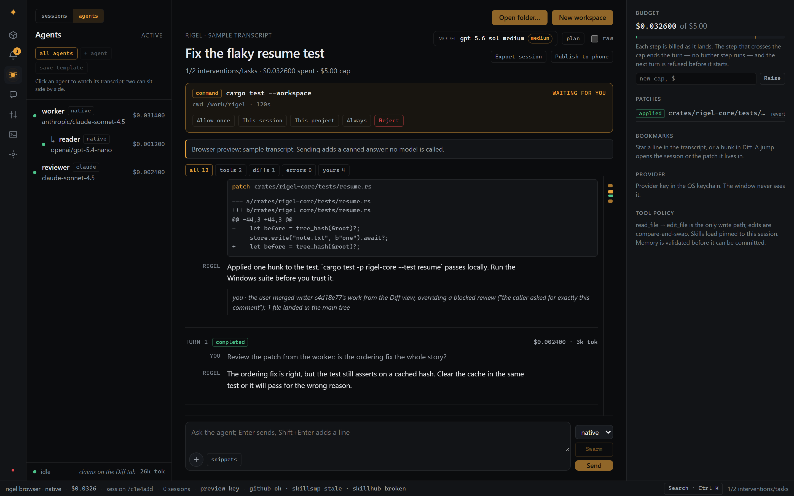
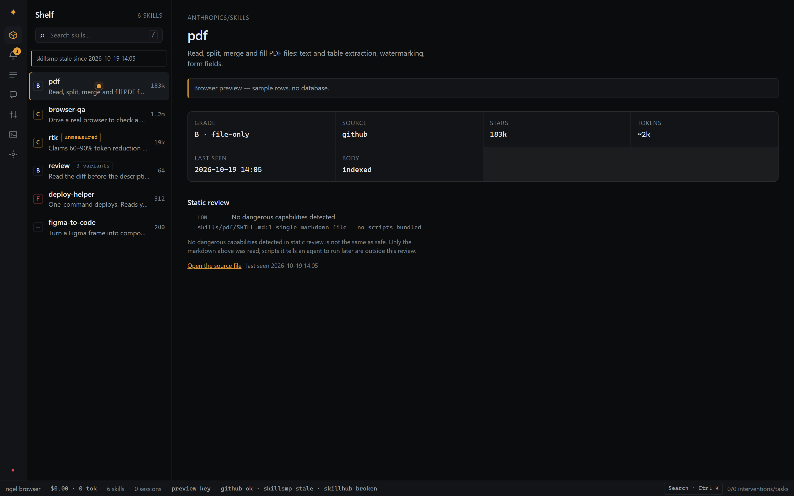
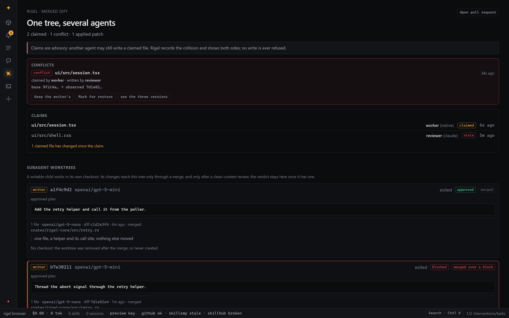
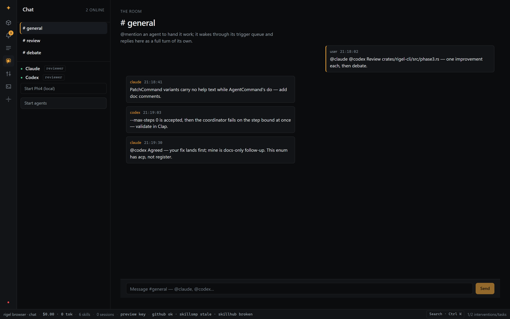
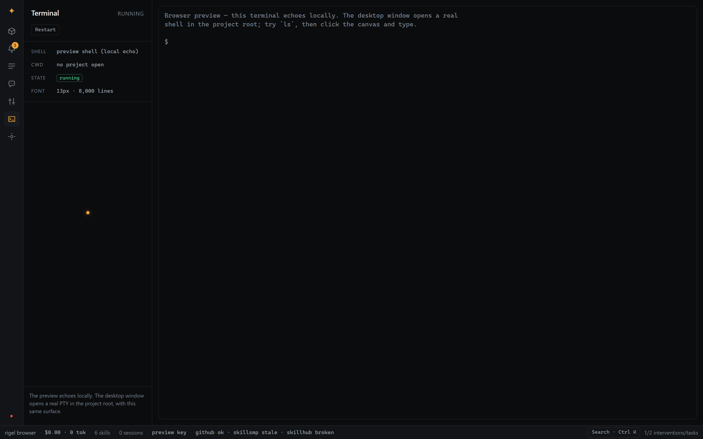

<div align="center">


# Rigel

**Several coding agents. One tree. One bill.**

A local-first window for Codex, Claude Code, Cursor, Cline and Rigel's own coordinator, working the
same project without silently overwriting each other.

[](https://github.com/OkVurb/Rigel/actions/workflows/ci.yml)
[](docs/PLATFORMS.md)
[](#licence)

</div>

**0.3.0 preview.** This tree ships the 0.3 runtime, safety and window wave. Verified on 2026-11-08:
the Rust workspace (53 test binaries), `cargo fmt` and clippy, the renderer build, the 55-test UI
end-to-end suite, the docs, claims, design and version checks, the Functions tests and the VPS
deploy checker are green. Of the [200-item roadmap](docs/roadmap-0.3.md), **71 items are done,
7 are blocked and 122 remain open**; the blocked set needs a signing certificate, a clean Windows
VM or GitHub-hosted release proof.



<p align="center"><sub>The session pane: roster, role-gutter transcript, approval card and bill. Captured from the current build.</sub></p>

## What it is

Rigel is a desktop window with one project database behind it. It runs your own agent CLIs and a
native coordinator, records every turn, attributes every file write, and shows the bill per agent
instead of as one opaque total.

Claims are advisory, not locks. When two agents do touch one file, the diff shows base, ours and
theirs, and the resolution lands through the same patch journal as everything else. The window
closes to the tray, so a running session is not interrupted by losing the window.

## What it does

| Surface | What is there |
|---|---|
| **Sessions** | A roster, a role-gutter transcript, streaming turns, an outline, bookmarks, templates, and a resume that reconciles the journal instead of replaying it. |
| **Claims and merge** | Advisory claims with tombstones and a 24-hour expiry, a 250 ms attribution watcher, a three-way merge, and a CAS patch journal with one revert per patch. |
| **Budget and safety** | Micro-dollar accounting per turn and per child, a preflight estimate, an 80% warning, and a $20/day project cap that refuses the next turn before it starts. |
| **Skill shelf** | An offline SQLite FTS5 index, SimHash duplicate clusters, six static capability rules with `file:line` evidence, and source health read without a network call. |
| **Terminal** | A real PTY in the project root, live font and scrollback settings, and a command gate that names the exact text, cwd and timeout before approval. |
| **Cloud and phone** | An opt-in Firebase project you own, shelf metadata with tombstones, one published session readable on an iPhone, and a read-only web reader. |
| **Routing and doors** | One resolver decides the provider and model; the inspector and `rigel route explain` print selected, requested, resolved, reason and the mismatch sentence. Launch health probes every credentialed door, and aliases resolve to the pair they name. |
| **Runtime control** | Plan mode with one approval per plan, steering at a step boundary, pause across a restart, crash recovery with tombstones, deterministic replay, compaction at 80% of the window and per-step cost and timing. |
| **Subagents** | Four read-only children with a parent DAG; write mode gives a child a worktree, per-file claims and a reviewed merge. |
| **Home** | The Rigel Paper: each local day set as a broadsheet from the session database, with a lead story, dispatches, a plate, the day's numbers and a rack of earlier days. |
| **Headless API** | `rigel serve` exposes the same coordinator over loopback HTTP with bearer auth, an OpenAPI 3.1 spec and SSE. |
| **Site and CMS** | A static site plus a Payload CMS; the VPS stack (Caddy, Fastify API, Postgres) is documented in [deploy/README.md](deploy/README.md). |

The long version of each, including where it stops, is in [docs/what-works.md](docs/what-works.md).

## New in the 0.3 tree

- **One route, made legible.** A saved pair, a picker pair, a role preset and a bare-id repair all
  pass through one resolver; the inspector and `rigel route explain` print the same decision, and a
  door that is down becomes a visible health row rather than a silent switch.
- **Doors for every key, and two without one.** Local Ollama and llamafile rows need no key, a
  custom OpenAI-compatible door is validated and written only to the keychain, and OpenRouter
  provider order, fallbacks and quantisations come from `.rigel/routing.json`.
- **A turn you can stop and keep.** Pause at a step boundary and resume after a restart with the
  same messages and budget, steer the next step, continue with a fresh bound, and recover a crashed
  turn with resume, read-only or a discard tombstone.
- **Plans and a subagent graph.** Plan mode proposes the tools and asks once; a tool outside the
  approved set re-arms the gate. Child agents declare dependencies, and a writable child lands only
  through its worktree and a reviewed merge.
- **Proof under the surface.** Migration-prefix rehearsal, fuzzed parsers, a file jail, redaction
  and pre-write secret scanning, prompt-injection tagging, tool-call repair, context estimation and
  a bounded diagnostic ring — each with its named test in the roadmap.
- **A headless door.** `rigel serve` gives an external orchestrator the same coordinator with
  OpenAPI 3.1, bearer auth and SSE; it binds loopback by default and refuses `0.0.0.0`.
- **The window catches up.** The Rigel Paper home surface, recovery and subagent views, route
  inspector, a token-only design system, eight-state and keyboard audits, focus mode and a real PTY
  that refits on resize.


## Install

Download the MSI from [Releases](https://github.com/OkVurb/Rigel/releases/latest). The installer
ships MSI and NSIS builds for Windows 10 1809 and newer; no Node, Python or Rust is needed once it
has run.

To build the desktop app from source, build the renderer first: the Tauri shell embeds `ui/dist` at
compile time.

```bash
git clone https://github.com/OkVurb/Rigel
cd Rigel
cd ui && npm install && npm run build && cd ..
cargo build --workspace
cargo run -p rigel-app
```

Or install only the CLI:

```bash
cargo install --path crates/rigel-cli
rigel skills index anthropics/skills --limit 20
rigel skills search "pdf"
rigel doctor
```

`rigel doctor` prints one row per check and exits `0` clear, `1` warnings, `2` failures. The Chat
sidecar is built once on Windows before packaging; [CONTRIBUTING.md](CONTRIBUTING.md) has that step
and the rest of the build setup.

## How a turn works

1. **Pick the door.** The model picker merges every provider you hold a key for, capped at six rows.
   A stored key is the permission; a model id never reaches a provider that does not own it.
2. **Answer the gate.** A command shows its exact text, cwd and timeout first. A destructive command
   also names its policy rows, gets one round of three read-only advisors, and captures a snapshot.
3. **Read the record.** Patches land through a compare-and-swap check and a write-ahead journal. The
   diff names the writer, the turn and the model; the bill is per agent.

## Screenshots

| The shelf, offline | Conflicts, not locks |
|---|---|
|  |  |

| The chat room | A real shell |
|---|---|
|  |  |

Every image is a capture of the built app. The [tour](web/shots/rigel-tour-2026.mp4) shows the
shelf, palette, session, chat, diff, terminal and settings in order.

## Cloud is optional

Rigel is offline unless you point it at a Firebase project you own. Push mirrors shelf metadata,
never a skill body. Publish writes one session's prompts and the assistant's own words, never tool
calls, command output or your project path. A removed row travels as a tombstone, so a pull does not
resurrect it.

Account credentials stay in the OS keychain; the renderer never sees the refresh token. App Check is
an optional custom provider that verifies a per-install token in constant time and rate-limits minting.
[docs/cloud.md](docs/cloud.md) has the setup and the document shape.

## The site, the CMS and the VPS stack

`askrigel.com` is a static build of `web/`. The stack in [deploy/README.md](deploy/README.md) runs
Caddy at the edge, a Fastify API at `api.askrigel.com`, a Payload CMS at `admin.askrigel.com` and one
Postgres container with separate `rigel` and `rigel_cms` databases; the site is mounted into Caddy
from the build in `.deploy/`. `node deploy/check.mjs` validates the production env file, both
Dockerfiles, the compose file, the Caddy targets and the built site without touching the server; the
runbook has the bootstrap, DNS, TLS, backup and rollback steps.

The Firebase project is still the reader's auth and data path: the web reader signs in directly, and
`/api/contact` plus `/api/gravity-ad` are reverse-proxied to the existing Functions until the
Fastify routes replace them. The migration is staged so either side can be rolled back.

## What works, and what does not

[docs/what-works.md](docs/what-works.md) is the table this README answers to. It marks each surface
**real**, **protocol**, or **not ported**, and names the evidence.

The gaps are part of the record:

- **122 roadmap items are still open.** [docs/roadmap-0.3.md](docs/roadmap-0.3.md) lists each with
  its artifact and its "done when"; the seven blocked items need a signing identity, a clean Windows
  VM or GitHub-hosted release proof. No open item is described here as finished.
- **The signed release is not cut.** 0.3.0 has no published installer, provenance or receipt; the
  version agrees across the four build files, but signing credentials are not in this tree.
- **The VPS API is partial.** Health, auth, devices, sessions, published sessions and the relay are
  implemented; the cloud, files, LLM, contact and ad routes still live on Firebase or the bridge.
- **The web reader still talks to Firebase.** The static site is hosted by Caddy, not the reader.
- **Cloud is exercised against a local stand-in** for the Firebase hosts, not a live project owned
  by the repository.
- **The iPhone client is compiled, not device-tested.** Uploads and the charge gesture have unit
  coverage; no simulator rendered them on this machine.
- **Muse Code, Gemini CLI, Cursor and Cline are verified against scripted implementations**, because
  none of those CLIs is installed on the build machine; a live Claude subscription turn has not run.
- **The keyboard exit test runs in the browser preview**, not against a packaged build; that
  real-build walk is the remaining proof.
- The static safety scan is not a proof that a skill is harmless. `A` is unreachable from a static
  scan and stays reserved.
- The merge reviewer is a model, not a proof. The patch journal and the worktree are what make a bad
  merge recoverable.

## Docs

- [ARCHITECTURE.md](ARCHITECTURE.md): the pieces, the two databases, the write path and a turn
- [docs/what-works.md](docs/what-works.md): every surface, its state and its evidence
- [CONTRIBUTING.md](CONTRIBUTING.md): build, checks, layout and the rules for a schema change
- [SECURITY.md](SECURITY.md): the threat model, every network call and what is not defended
- [docs/privacy.md](docs/privacy.md): what stays local and what leaves
- [docs/PLATFORMS.md](docs/PLATFORMS.md): Windows support, signing and what macOS/Linux mean here
- [docs/cloud.md](docs/cloud.md): the Firebase project, the account and the document shape
- [docs/roblox.md](docs/roblox.md): Roblox Studio MCP, 3D assets, animations and sound effects
- [docs/design.md](docs/design.md): surface jobs, the token contract and the responsive breakpoints
- [docs/api.md](docs/api.md): `rigel serve`, bearer auth, OpenAPI and the endpoint table
- [docs/threat-model.md](docs/threat-model.md): five threats and what is, and is not, defended
- [docs/troubleshooting.md](docs/troubleshooting.md): real error strings and the fix for each
- [docs/adr/README.md](docs/adr/README.md): the routing, storage, approval and cloud decisions
- [deploy/README.md](deploy/README.md): the VPS runbook, DNS, TLS, backup and rollback
- [cms/README.md](cms/README.md): the Payload content and admin backend for the website
- [docs/roadmap-0.2.md](docs/roadmap-0.2.md): what 0.2.0 closed, and the round-9 work that moved past it
- [docs/roadmap-0.3.md](docs/roadmap-0.3.md): the next 200, with the Hallmark design doctrine and the repo/skill research
- [docs/sprint-0.3-wave-1.md](docs/sprint-0.3-wave-1.md): the executable proof-and-safety sprint for the first wave

## Contributing

The checks are the ones CI runs:

```bash
cargo fmt --all -- --check
cargo clippy --workspace --all-targets -- -D warnings
cargo test --workspace
(cd ui && npx tsc --noEmit && npm run build && npm run test:e2e)
node scripts/check-docs.mjs
node scripts/release-check.mjs
```

A schema change is a new numbered file in `migrations/` plus a `Migration` entry; an applied
migration is never edited. Fix a failing test by fixing the cause: no ignored test, no weakened
assertion, no silenced lint.

Security reports go to `security@rigel.invalid`, as [SECURITY.md](SECURITY.md) describes, not to the
issue tracker.

## Licence

MIT OR Apache-2.0, at your option. The texts are in [LICENSE-MIT](LICENSE-MIT) and
[LICENSE-APACHE](LICENSE-APACHE). The installer's Chat sidecar also bundles agentchattr (MIT) and
Python (PSF); the build writes their notices to `resources/sidecar/THIRD-PARTY-NOTICES.txt`.

No contributor licence agreement, and no telemetry to opt out of.
